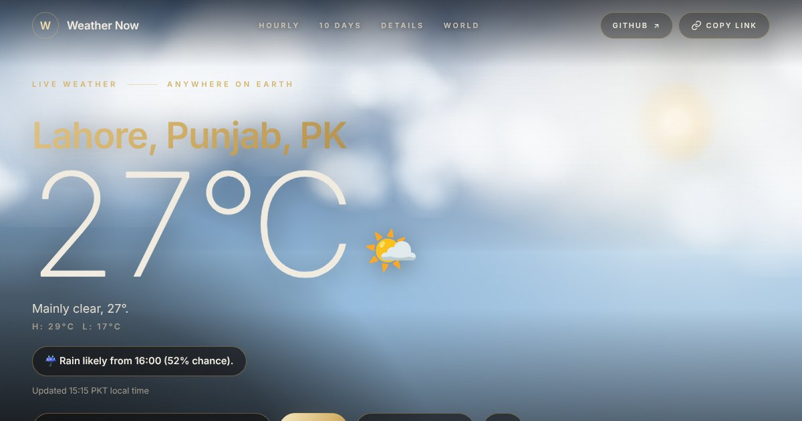
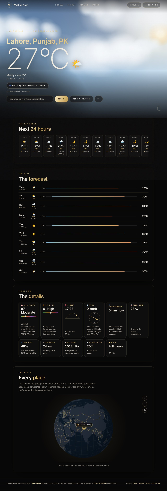

# Weather Now

[](https://github.com/umer-78/weather-now/actions/workflows/ci.yml)

[](https://umer-78.github.io/weather-now/)


**Live:** https://umer-78.github.io/weather-now/

Current conditions, the next 24 hours, a 10-day forecast and air quality, from
[Open-Meteo](https://open-meteo.com/) — which needs no API key and no sign-up.
No framework, no build step, no tracking.



<sub>Screenshot rendered with a fixed sample response so it looks the same every time.</sub>

## Features

- **A 3D sky that is the weather.** Behind the page, a three.js scene shows the
  weather at the place on screen: the sky's colour follows the time of day, the
  sun crosses on its arc and the moon shows its real phase among the stars,
  clouds gather with the cloud cover and drift with the real wind, rain and snow
  fall as hard as they are falling there, storms flash, and poor visibility hangs
  as mist. Golden hour turns the horizon gold. Without WebGL the page keeps a
  still gradient in the same mood.
- **Designed like the [portfolio](https://umer-78.github.io/)**: obsidian, ivory
  and champagne gold, glass panels and film grain, set in Inter: a clean sans
  close to the San Francisco font of Apple's weather app, with a thin, large
  temperature
- City search with disambiguation (three Lahores? pick the right one), typed
  coordinates (`31.56, 74.35`), and "use my location" through the browser's
  geolocation — high accuracy, named with the town it found, and a warning when
  the browser can only place you roughly
- **Rain check**: the chance of rain this hour and when rain (or snow) is next likely, in the next 24 hours
- **Detail tiles**, as on a phone's weather app, each with what the number means: air quality (US AQI, PM2.5),
  UV with the WHO advice band, sunrise/sunset with the sun's place on its arc, wind on a compass with gusts,
  precipitation, feels-like (and why), humidity with the **dew point and comfort level**, visibility,
  pressure and whether it is rising or falling, cloud cover, and the moon's phase
- 24-hour strip that starts from **now**, not from midnight, with night-time icons after dark, rain chance,
  amount and wind for each hour
- 10-day forecast whose range bars share **one scale**, so days compare at a glance, with each day's
  rain chance, amount and strongest wind
- **3D world map**: drag the globe, zoom with the scroll wheel, a pinch, the + / −
  buttons or keys, and it stays sharp — once zoomed, the part of the world in view
  is redrawn at screen resolution. Keep zooming and it becomes an OpenStreetMap
  street map, down to single houses with every town's and street's name; zoom
  back out, or press 🌐, for the globe. Click anywhere, or on a city's name, for
  the weather there, named down to the street. The pin shows the place and its
  temperature, the caption the exact coordinates and the elevation the forecast
  was made for
- Stays current: an open tab reloads once its data is 15 minutes old, and shows when it was updated
- °C / °F toggle (wind and visibility follow: km/h or mph, km or miles), remembered along with your last place
- Light and dark theme, and a layout that works on a phone

## What is tested

`src/weather.js` holds the logic with no DOM in it, so it can be tested with
Node's runner:

```bash
node --test      # 38 tests
```

Covering the WMO weather-code table, temperature conversion and rounding,
compass directions across all four quadrants and negative bearings, UV bands,
wind chill only applying when it is cold and windy, the "feels like" phrasing
rule (in °C and °F), night icons, UV bands on the rounded index, precipitation
amounts, range bars on a shared scale, wind in km/h or mph, the rain check (today
or tomorrow, rain or snow), air-quality bands, the moon's phase against known new
and full moons, the pressure trend, which sky to draw for each kind of weather
(clouds, rain, mist, night and golden hour from the measured amounts), typed coordinates,
naming a spot from OpenStreetMap at the map's zoom, the globe maths (a click
maps back to the same coordinates, turning brings a place to face you, and the
sharp zoomed-in view lines up with the globe, across the date line too), and —
the one that
actually bit — the hourly list starting from the current hour rather than from
the first hour of the day.

## Run it

```bash
git clone https://github.com/umer-78/weather-now.git
cd weather-now
node --test
python3 -m http.server 8080
# open http://localhost:8080
```

## Notes

- Open-Meteo is free for non-commercial use and rate-limited; the page makes one
  forecast call per place, not one per render.
- Geolocation only runs when you press the button. The coordinates, rounded to
  about 100 m, go to Open-Meteo for the forecast and to OpenStreetMap's
  [Nominatim](https://nominatim.org/) for the town's name, and nowhere else.
  Names for spots clicked on the map come from Nominatim too, at most one
  lookup a second as its usage policy asks.
- The sky (`src/sky.js`) renders at a capped resolution, steps down on devices
  that cannot keep up, pauses when the tab is hidden and holds still for reduced
  motion; `src/mood.js` decides what it shows, and is tested.
- The font is Inter (SIL Open Font License, `assets/fonts`), served with the page.
- The street map is OpenStreetMap's own map, drawn with [Leaflet](https://leafletjs.com/)
  and loaded only when you first zoom in that far. Air quality comes from
  Open-Meteo's air-quality service; if it does not answer, the page leaves that
  tile out.
- The globe's coastlines and borders are Natural Earth (public domain) from the
  `world-atlas` package on jsDelivr, drawn with three.js; zoomed in, it switches
  to the finer 1:50m data. If the phone takes the GPU back under memory pressure
  the globe waits and draws again, and without WebGL the map card stays hidden
  and the rest of the page is unchanged.
- `localStorage` is wrapped in try/catch, so private mode degrades to "no saved
  place" instead of a blank page.

## License

[MIT](LICENSE)
