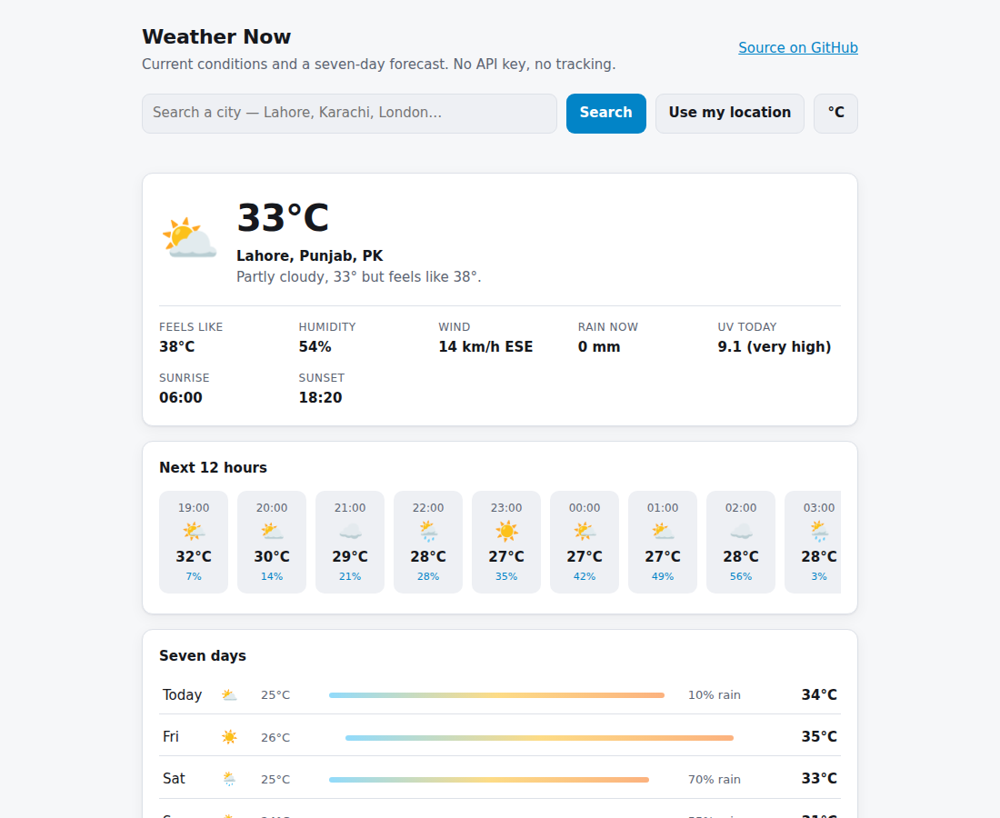

# Weather Now

[](https://github.com/umer-78/weather-now/actions/workflows/ci.yml)

[](https://umer-78.github.io/weather-now/)


**Live:** https://umer-78.github.io/weather-now/

Current conditions, the next twelve hours and a seven-day forecast, from
[Open-Meteo](https://open-meteo.com/) — which needs no API key and no sign-up.
No framework, no build step, no tracking.



<sub>Screenshot rendered with a fixed sample response so it looks the same every time.</sub>

## Features

- City search with disambiguation (three Lahores? pick the right one), typed
  coordinates (`31.56, 74.35`), and "use my location" through the browser's
  geolocation — high accuracy, named with the town it found, and a warning when
  the browser can only place you roughly
- Feels-like, humidity, **dew point with a comfort level**, wind speed, **gusts and compass direction**, rain, UV with the
  WHO advice band, sunrise and sunset
- Hourly strip that starts from **now**, not from midnight, with night-time icons after dark
- **Precipitation**: chance and amount (mm) now, for each hour and for each day
- Seven-day forecast whose range bars share **one scale**, so days compare at a glance
- **3D world map**: drag the globe, zoom up to 12× with the scroll wheel, a pinch,
  the + / − buttons or keys, and it stays sharp — once zoomed, the part of the
  world in view is redrawn at screen resolution. City names appear as you zoom
  in; click anywhere, or on a city's name, for the weather there. The pin shows
  the place and its temperature, the caption the exact coordinates and the
  elevation the forecast was made for
- Stays current: an open tab reloads once its data is 15 minutes old, and shows when it was updated
- °C / °F toggle (wind follows: km/h or mph), remembered along with your last place
- Light and dark theme, and a layout that works on a phone

## What is tested

`src/weather.js` holds the logic with no DOM in it, so it can be tested with
Node's runner:

```bash
node --test      # 27 tests
```

Covering the WMO weather-code table, temperature conversion and rounding,
compass directions across all four quadrants and negative bearings, UV bands,
wind chill only applying when it is cold and windy, the "feels like" phrasing
rule (in °C and °F), night icons, UV bands on the rounded index, precipitation
amounts, range bars on a shared scale, wind in km/h or mph, typed coordinates,
naming a spot from OpenStreetMap at the map's zoom, the globe maths (a click
maps back to the same coordinates, turning brings a place to face you, and the
sharp zoomed-in view lines up with the globe, across the date line too), and —
the one that
actually bit — the hourly list starting from the current hour rather than from
the first hour of the day.

## Run it

```bash
git clone https://github.com/umer-78/weather-now.git
cd weather-now
node --test
python3 -m http.server 8080
# open http://localhost:8080
```

## Notes

- Open-Meteo is free for non-commercial use and rate-limited; the page makes one
  forecast call per place, not one per render.
- Geolocation only runs when you press the button. The coordinates, rounded to
  about 100 m, go to Open-Meteo for the forecast and to OpenStreetMap's
  [Nominatim](https://nominatim.org/) for the town's name, and nowhere else.
  Names for spots clicked on the map come from Nominatim too, at most one
  lookup a second as its usage policy asks.
- The globe's coastlines and borders are Natural Earth (public domain) from the
  `world-atlas` package on jsDelivr, drawn with three.js; zoomed in, it switches
  to the finer 1:50m data. If the phone takes the GPU back under memory pressure
  the globe waits and draws again, and without WebGL the map card stays hidden
  and the rest of the page is unchanged.
- `localStorage` is wrapped in try/catch, so private mode degrades to "no saved
  place" instead of a blank page.

## License

[MIT](LICENSE)
